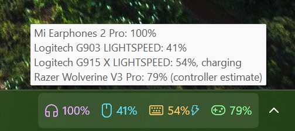
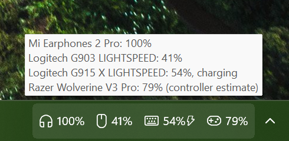
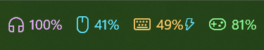
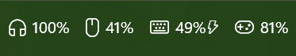
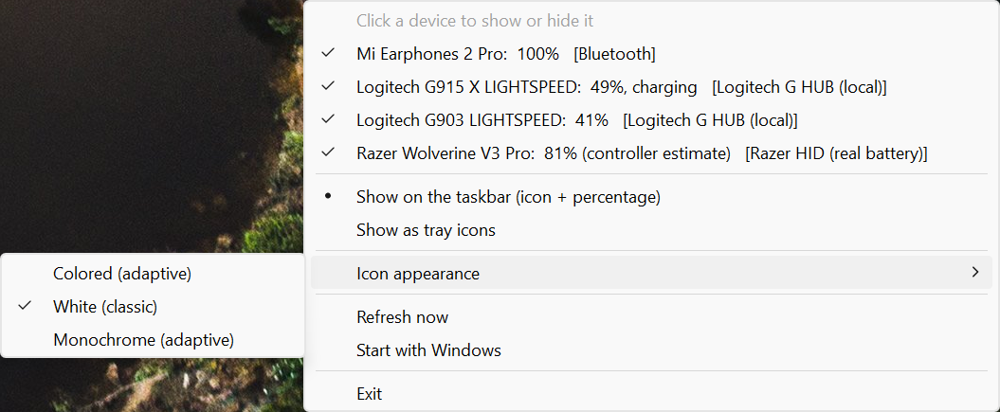
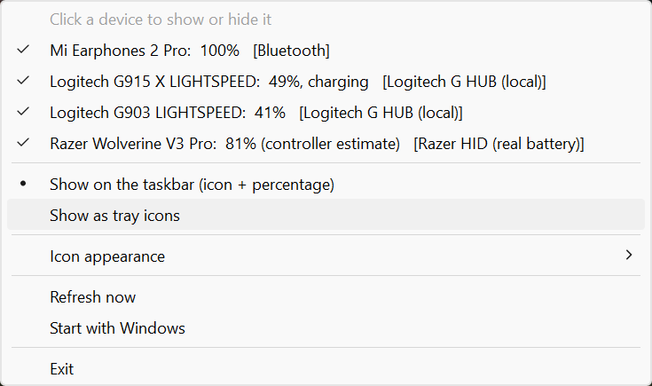

<div align="center">


# DrayBattery

**Battery levels for your devices. Right where you need them.**

A lightweight Windows battery monitor that puts connected peripherals and gamepads
on your taskbar or in your notification area.

[**Download latest release**](https://github.com/deepsky303/DrayBattery/releases/latest) ·
[**Русская версия**](README.ru.md) ·
[Device support](docs/device-support.md) ·
[Report a problem](https://github.com/deepsky303/DrayBattery/issues)

[](https://github.com/deepsky303/DrayBattery/releases/latest)
[](#installation)
[](https://github.com/deepsky303/DrayBattery/actions/workflows/windows.yml)
[](LICENSE)

</div>

---

## Preview

<div align="center">

**Live battery levels on the Windows taskbar**

| Colored · adaptive | White · classic |
|:---:|:---:|
|  |  |

<sub>Device icons, charging state, percentages and a single tooltip for all connected devices.</sub>

</div>

<details>
<summary><strong>More screenshots — taskbar, tray and appearance menu</strong></summary>

<p align="center">
  
  
</p>

| Icon appearance settings | Device management |
|:---:|:---:|
|  |  |

<p align="center">
  <strong>Notification area (tray) mode</strong><br>
  
</p>

</details>

## Why DrayBattery?

| | |
|---|---|
| **One glance, multiple devices** | Headphones, mice, keyboards and controllers displayed together instead of opening several vendor apps. |
| **Choose your look** | Colored, white or adaptive monochrome icons. The chosen style survives restarts. |
| **Two display modes** | Integrated taskbar widget or individual notification-area icons; automatic tray fallback when the widget is unavailable. |
| **Battery status you can trust** | Last-known readings are dimmed. Unknown levels stay unknown. Coarse XInput categories are never passed off as exact percentages. |
| **Smarter device matching** | Multiple connections are merged only where reliable physical identity is available. |
| **Local by design** | No account, cloud backend or telemetry service. Logitech G HUB integration uses localhost. |

## Installation

**Requirements:** Windows 10/11, x64. Developed and tested on Windows 11. Taskbar integration depends on Windows Explorer internals and may change after Windows updates; notification-area mode is the fallback.

| Package | Recommended for |
|:---|:---|
| **[Setup for Windows](https://github.com/deepsky303/DrayBattery/releases/latest)** (`DrayBattery-0.1.9-setup.exe`) | Per-user installation with Start Menu shortcut, optional desktop shortcut and an uninstaller |
| **[Portable ZIP](https://github.com/deepsky303/DrayBattery/releases/latest)** (`DrayBattery-0.1.9-portable.zip`) | Extract anywhere and run `DrayBattery.exe` |
| [Source code](https://github.com/deepsky303/DrayBattery) | Build it yourself or inspect the implementation |

The installer uses the current user account and doesn't require administrator privileges. **Autostart is disabled by default** and can be enabled from the application's context menu. Neither package installs device drivers.

### Quick start

1. Run `DrayBattery.exe` from the installer or extracted ZIP.
2. Find the battery widget beside the notification area, or the tray icons if the taskbar integration is unavailable.
3. Right-click any DrayBattery indicator for **Refresh now**, **Icon appearance**, device visibility and display mode.
4. For Razer Wolverine V3 Pro in Xbox Mode, use **Read Wolverine battery (Xbox mode)…** to refresh the GIP reading through a short foreground window.

## Device support

| Device/source | Battery reporting | Notes |
|---|---|---|
| Logitech G903 LIGHTSPEED | Verified | Local Logitech G HUB reading |
| Logitech G915 X LIGHTSPEED | Verified | Battery and charging, plus conservative cache while sleeping |
| Razer Wolverine V3 Pro — Windows Mode | Verified raw HID response | `1532:0A4C`; normalized controller-reported battery value |
| Razer Wolverine V3 Pro — Xbox Mode | Verified GIP response | `1532:0A3F`; foreground refresh required; stale readings are dimmed |
| Other supported hardware | Varies by model | Selected device-specific drivers plus standard HID, Bluetooth and Windows input fallbacks |

Additional drivers are inherited from the upstream project; they are **not all hardware-verified** in this derivative. Read the [device compatibility and identification guide](docs/device-support.md) before submitting a request for another model.

**Important:** USB VID/PID databases identify device types; they do not magically provide battery protocols or distinguish two physical units of the same model.

## Optional USB device identification database

**On demand**, DrayBattery can fetch the public hwdata/usb.ids catalogue with vendor and product names, store it locally and identify attached USB/HID devices. **It does not automatically provide a battery protocol.** No update request is sent during normal polling, and device identifiers are not uploaded.

Use **Update USB device names (online)…** from the context menu, or the commands below. Cached names work without internet. See the [expanded device compatibility table](docs/device-support.md) for families with actual battery drivers.

## How battery levels are displayed

- **Live reading:** reported by the device, local vendor software or a Windows interface.
- **Controller estimate:** Wolverine's raw 0–255 reading normalized to 0–100%; not a calibrated measurement of battery capacity.
- **Last known:** cached value when a device sleeps or the source no longer responds, displayed with reduced opacity.
- **Unknown:** `?` where no valid reading is available.
- **Coarse level:** `Empty`, `Low`, `Medium` or `Full` for XInput hardware that reports only a category.

## Settings

| Context menu | Action |
|---|---|
| Show on the taskbar / Show as tray icons | Switch the display mode |
| Icon appearance → Colored (adaptive) | Color-code devices and maintain background contrast |
| Icon appearance → White (classic) | Use white device icons and text |
| Icon appearance → Monochrome (adaptive) | Choose black or white based on the taskbar background |
| Device list | Show or hide an individual device |
| Refresh now | Request updated values |
| Read Wolverine battery (Xbox mode)… | Read the current GIP value in a focused window |
| Start with Windows | Toggle per-user autostart |
| Exit | Close the application |

## Troubleshooting

<details>
<summary><strong>The app is running but I can't see any icons</strong></summary>

Check the notification area, including Windows' hidden-icons arrow. Switch to **Show as tray icons**. After Explorer or a Windows update, restart DrayBattery if taskbar integration stops working.

</details>

<details>
<summary><strong>My Logitech device is missing or has an old value</strong></summary>

Confirm the device and receiver are connected. Open Logitech G HUB if using that integration, then select **Refresh now**. Sleeping hardware can temporarily report a last-known value.

</details>

<details>
<summary><strong>Wolverine Xbox Mode shows ? or a dimmed percentage</strong></summary>

Use **Read Wolverine battery (Xbox mode)…**. Windows may suspend the GIP input sink when the reader has no foreground focus.

</details>

<details>
<summary><strong>Why is a percentage different across connection modes?</strong></summary>

The value comes from the device's own battery field or another available interface, not a lab-grade battery gauge. Wolverine's normalized 0–255 value is a controller estimate. Cached and coarse values are labelled accordingly.

</details>

### Diagnostics

```cmd
DrayBattery.exe --list
DrayBattery.exe --dump
DrayBattery.exe --identify
DrayBattery.exe --db-info
DrayBattery.exe --update-device-db
DrayBattery.exe --quit
```

`--list` prints recognized battery devices, `--dump` lists detected HID collections, and `--quit` closes a running instance. **Check and redact unique identifiers before publicly sharing logs.**

## Build and contribute

Requires the Windows SDK and Visual Studio 2022 C++ tools (Build Tools, Community or Enterprise).

```cmd
build-msvc.cmd
run-tests-msvc.cmd
installer\build-installer.cmd
```

The portable executable is generated at `dist\DrayBattery.exe`. Building the installer additionally requires [Inno Setup 6](https://jrsoftware.org/isinfo.php).

Bug reports and compatible contributions are welcome. See [CONTRIBUTING.md](CONTRIBUTING.md), [CHANGELOG.md](CHANGELOG.md) and the [issues](https://github.com/deepsky303/DrayBattery/issues).

## Credits and license

DrayBattery is a derivative of [Wireless Device Battery Monitor](https://github.com/krisgfx9/Wireless-Device-Battery-Monitor) (upstream v1.0.4), distributed under **[GNU GPL-3.0-or-later](LICENSE)**. Copyright and attribution to upstream contributors are retained.

The Xbox GIP implementation incorporates protocol work from [Razer-Wolverine-Battery-Widget](https://github.com/2rx2/Razer-Wolverine-Battery-Widget) under the [MIT license notice](third_party/Razer-Wolverine-Battery-Widget.MIT.txt). The Windows Mode HID protocol was cross-checked against [wv3c](https://github.com/pascalfilippi/wv3c/blob/main/docs/protocol.md).

DrayBattery is an independent community project and is not affiliated with or endorsed by Logitech, Razer or Microsoft.
