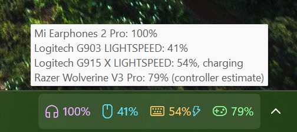
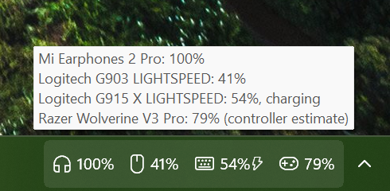
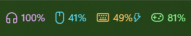
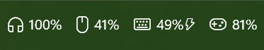
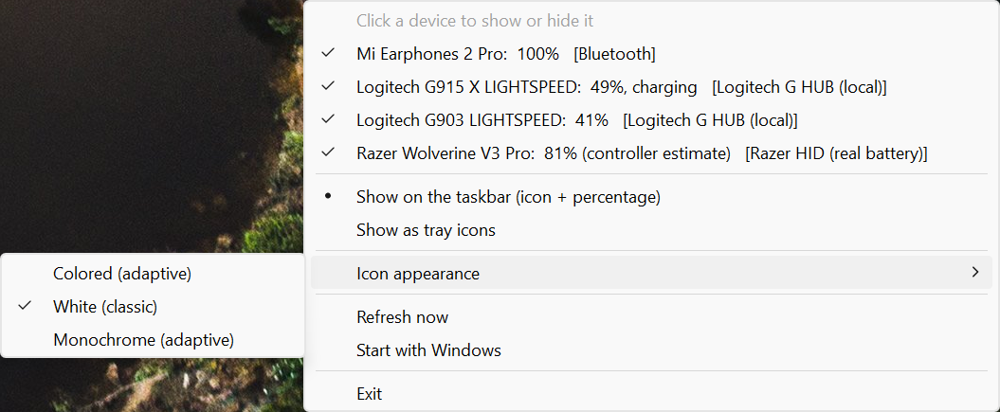
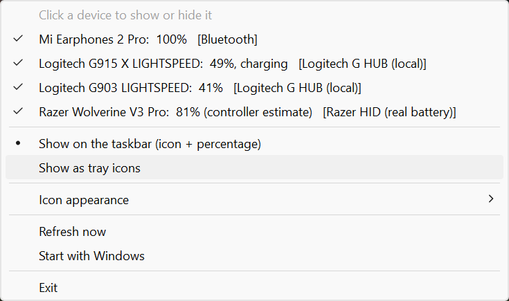

<div align="center">


# DrayBattery

**Заряд всех устройств — прямо перед глазами.**

Лёгкая утилита для Windows: показывает уровень аккумулятора мыши, клавиатуры,
наушников и геймпада на панели задач или в области уведомлений.

[**Скачать последнюю версию**](https://github.com/deepsky303/DrayBattery/releases/latest) ·
[**English**](README.md) ·
[Поддерживаемые устройства](docs/device-support.ru.md) ·
[Сообщить об ошибке](https://github.com/deepsky303/DrayBattery/issues)

[](https://github.com/deepsky303/DrayBattery/releases/latest)
[](#установка)
[](https://github.com/deepsky303/DrayBattery/actions/workflows/windows.yml)
[](LICENSE)

</div>

---

## Как это выглядит

<div align="center">

**Заряд устройств на панели задач Windows**

| Цветные · адаптивные | Белые · классические |
|:---:|:---:|
|  |  |

<sub>Значки устройств, зарядка, проценты и общая подсказка со всеми подключёнными устройствами.</sub>

</div>

<details>
<summary><strong>Больше скриншотов — панель задач, трей и меню оформления</strong></summary>

<p align="center">
  
  
</p>

| Настройка оформления | Контекстное меню |
|:---:|:---:|
|  |  |

<p align="center">
  <strong>Режим значков в трее</strong><br>
  
</p>

</details>

## Возможности

| | |
|---|---|
| **Все устройства вместе** | Наушники, мыши, клавиатуры и контроллеры — без необходимости открывать несколько фирменных программ. |
| **Три варианта оформления** | Цветной, белый и адаптивный монохромный. Выбор сохраняется между запусками. |
| **Два режима отображения** | Виджет на панели задач или отдельные иконки в трее. Если виджет недоступен, используется трей. |
| **Без выдуманных процентов** | Устаревшее значение приглушается, неизвестное остаётся неизвестным, а категории XInput не маскируются под точные цифры. |
| **Объединение подключений** | Дубликаты разных способов подключения объединяются только при наличии надёжного идентификатора устройства. |
| **Локальная работа** | Нет учётной записи, облачного сервиса или телеметрии. Для Logitech G HUB используется локальное соединение. |

## Установка

**Требования:** Windows 10/11, x64. Разработка и аппаратные проверки проводились на Windows 11. Виджет зависит от внутреннего устройства панели задач Explorer, которое может меняться после обновлений Windows; резервный режим — иконки трея.

| Файл | Для чего |
|:---|:---|
| **[Установщик Windows](https://github.com/deepsky303/DrayBattery/releases/latest)** (`DrayBattery-0.1.8-setup.exe`) | Установка для текущего пользователя, ярлык в «Пуск», необязательный ярлык на рабочем столе, штатное удаление |
| **[Портативная версия](https://github.com/deepsky303/DrayBattery/releases/latest)** (`DrayBattery-0.1.8-portable.zip`) | Распаковать и запустить `DrayBattery.exe` без установки |
| [Исходный код](https://github.com/deepsky303/DrayBattery) | Изучение исходников, самостоятельная сборка, доработки |

Установщик не требует прав администратора. **Автозапуск изначально отключён** — включается вручную через контекстное меню. Драйверы устройств не устанавливаются и не заменяются.

### Быстрый старт

1. Запусти `DrayBattery.exe` после установки или распаковки архива.
2. Найди виджет рядом с областью уведомлений Windows либо иконки в трее, если встроить виджет не удалось.
3. Нажми правой кнопкой по индикатору: доступны **Refresh now**, **Icon appearance**, показ/скрытие устройств и режим отображения.
4. Для Razer Wolverine V3 Pro в режиме Xbox воспользуйся **Read Wolverine battery (Xbox mode)…** — команда открывает короткое окно в фокусе для получения ответа GIP.

## Поддерживаемые устройства

| Устройство / источник | Показания заряда | Особенности |
|---|---|---|
| Logitech G903 LIGHTSPEED | Проверено | Локальный интерфейс Logitech G HUB |
| Logitech G915 X LIGHTSPEED | Проверено | Заряд, состояние зарядки, осторожное кэширование во сне |
| Razer Wolverine V3 Pro — Windows Mode | Проверен сырой отчёт HID | `1532:0A4C`; оценка контроллера, пересчитанная в проценты |
| Razer Wolverine V3 Pro — Xbox Mode | Проверен ответ GIP | `1532:0A3F`; требуется обновление в активном окне, старые данные приглушаются |
| Другие устройства | Зависит от конкретной модели | Отдельные драйверы, стандартные HID/Bluetooth-интерфейсы и средства Windows |

Некоторые драйверы перенесены из исходного проекта и **не проходили испытания на всём оборудовании**. Подробности — в [справочнике по совместимости и распознаванию](docs/device-support.ru.md).

**Важно:** база USB VID/PID позволяет определить тип устройства, но сама по себе не умеет считывать аккумулятор и не различает два экземпляра одной модели.

## Откуда берутся проценты

- **Текущее показание:** предоставлено самим устройством, локальной программой производителя или интерфейсом Windows.
- **Оценка контроллера:** у Wolverine значение 0–255 пересчитывается в шкалу 0–100%; это не лабораторное измерение ёмкости аккумулятора.
- **Последнее известное:** значение из кэша, если устройство уснуло или перестало отвечать; показывается с уменьшенной яркостью.
- **Нет данных:** знак `?` вместо выдуманного процента.
- **Грубый уровень:** `Empty`, `Low`, `Medium` или `Full` для устройств XInput, которые не передают точную цифру.

## Настройки

| Пункт меню | Назначение |
|---|---|
| Show on the taskbar / Show as tray icons | Переключить виджет и иконки трея |
| Icon appearance → Colored (adaptive) | Цветные иконки с адаптацией к фону |
| Icon appearance → White (classic) | Белые значки устройств и цифры |
| Icon appearance → Monochrome (adaptive) | Автоматический выбор белого или чёрного цвета |
| Список устройств | Показать или скрыть отдельное устройство |
| Refresh now | Принудительный опрос |
| Read Wolverine battery (Xbox mode)… | Считать GIP в окне на переднем плане |
| Start with Windows | Включить или отключить автозапуск для текущего пользователя |
| Exit | Завершить программу |

## Решение проблем

<details>
<summary><strong>Программа запущена, но индикаторов не видно</strong></summary>

Проверь область уведомлений Windows, в том числе значки под стрелкой. Переключись в **Show as tray icons**. После перезапуска Explorer или обновления Windows может потребоваться перезапуск DrayBattery.

</details>

<details>
<summary><strong>Logitech не определяется или показывает старый процент</strong></summary>

Убедись, что приёмник подключён и устройство включено. Если используется интеграция G HUB — запусти её, затем выбери **Refresh now**. Спящие устройства могут временно отображаться с последним известным значением.

</details>

<details>
<summary><strong>В Xbox Mode у Wolverine знак ? или тусклый процент</strong></summary>

Нажми **Read Wolverine battery (Xbox mode)…**. Windows может приостанавливать ответы GIP, когда специальное окно считывателя не находится в фокусе.

</details>

<details>
<summary><strong>Почему уровень заряда отличается в разных режимах?</strong></summary>

Это данные самого устройства и доступных интерфейсов, а не точный измеритель физической ёмкости аккумулятора. Значение Wolverine 0–255 преобразуется в оценочный процент. Кэш и грубые категории помечаются отдельно.

</details>

### Диагностика

```cmd
DrayBattery.exe --list
DrayBattery.exe --dump
DrayBattery.exe --quit
```

`--list` выводит найденные устройства с зарядом, `--dump` — HID-интерфейсы, `--quit` — закрывает работающую программу. **Перед публикацией диагностики удали серийные номера и другие уникальные данные.**

## Сборка и участие в разработке

Нужны Windows SDK и инструменты C++ из Visual Studio 2022 (Build Tools, Community или Enterprise).

```cmd
build-msvc.cmd
run-tests-msvc.cmd
installer\build-installer.cmd
```

Портативный EXE создаётся в `dist\DrayBattery.exe`. Для сборки установщика дополнительно требуется [Inno Setup 6](https://jrsoftware.org/isinfo.php).

Предложения и сообщения об ошибках принимаются в [Issues](https://github.com/deepsky303/DrayBattery/issues). Также смотри [CONTRIBUTING.md](CONTRIBUTING.md) и [CHANGELOG.md](CHANGELOG.md).

## Исходный проект и лицензии

DrayBattery — производная версия [Wireless Device Battery Monitor](https://github.com/krisgfx9/Wireless-Device-Battery-Monitor), созданная на основе v1.0.4. Распространяется по лицензии **[GNU GPL-3.0-or-later](LICENSE)** с сохранением авторских прав и указанием исходных разработчиков.

Реализация Xbox GIP использует исследования [Razer-Wolverine-Battery-Widget](https://github.com/2rx2/Razer-Wolverine-Battery-Widget) под [MIT](third_party/Razer-Wolverine-Battery-Widget.MIT.txt). Протокол HID для Windows Mode сверялся с [wv3c](https://github.com/pascalfilippi/wv3c/blob/main/docs/protocol.md).

DrayBattery — независимый проект сообщества; не связан с Logitech, Razer или Microsoft и не одобрен этими компаниями.
